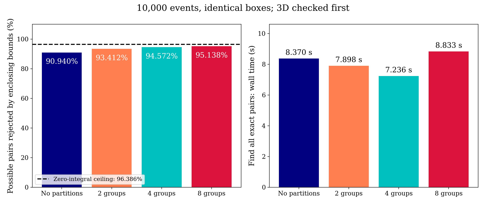
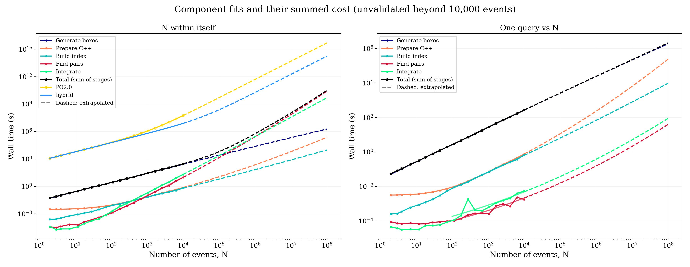
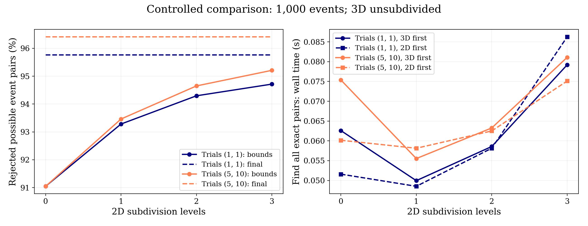
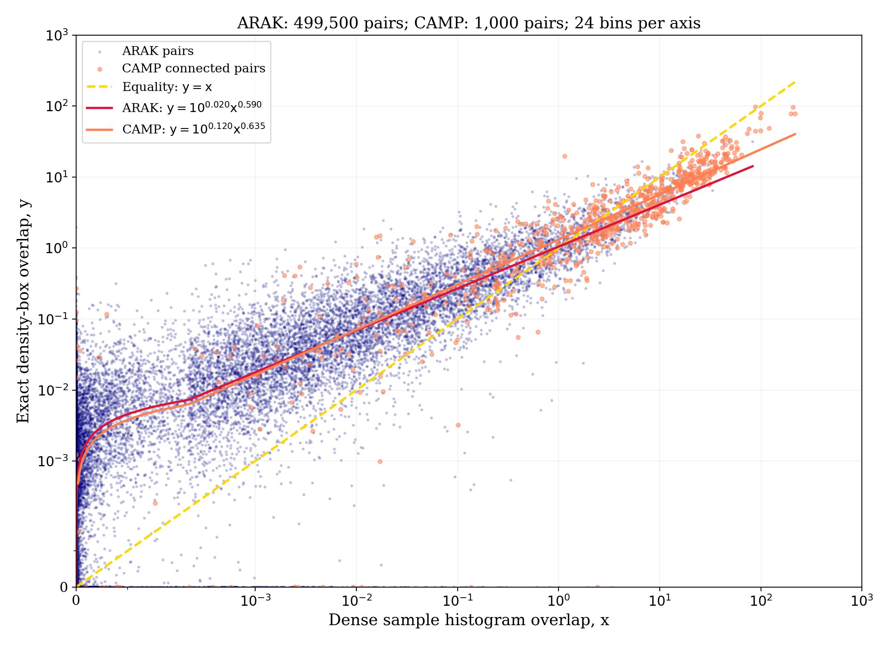

# Probability overlap calculation: algorithms, validation and experiments

## Scientific model

An event is represented by two independent probability blocks,
$P(\theta)=P_0(\theta_0)P_1(\theta_1)$, normally with three and two coordinates.
Each block is approximated by disjoint constant-density axis-aligned boxes.
The independence assumption and uniform density within boxes are approximations
of the sampled distribution. Integration is analytic and exact for this box model;
it is not an exact reconstruction of the original sampled density.

The measured event integral is the product of the two block integrals. Demonstrations
use unit weights. Stored block weights support the prescribed volume-fraction
interpolation, but do not represent a general weight coupling both blocks.
NumPy input is implemented; Bilby and Feather adapters remain outside this stage.

## Algorithms and parameters

### Disjoint density boxes

For each block and random trial, selected sample coordinates are sorted independently.
Adjacent selected values define midpoint separators; global sample extrema supply
the two outer separators. The Cartesian product defines preliminary cells. Only
occupied cells are constructed by sorting sample cell indices and reducing sample
minima/maxima within each group. Cells containing fewer than two samples are removed.
Every retained cell shrinks to the bounding box of its assigned samples.

For a retained box with $n_B$ of $N$ original samples and hypervolume $V_B$,

$$p_B=\frac{n_B}{NV_B},\qquad P_{\mathrm{retained},b}=\sum_B p_BV_B.$$

The joint retained probability is the product of block retained probabilities.
Loss above 0.1% emits a warning. Singleton mass is neither merged nor renormalized.
Degenerate retained volumes intentionally expose data issues through infinity or NaN.
Since each final box stays within its preliminary cell, final interiors are disjoint.
Overlapping projections of 3D boxes do not imply overlapping 3D interiors.

The trial objective is $H_t=\sum_{B\in t}V_B$; the lowest-volume trial is selected,
with ties retaining the first. Defaults are five trials in 3D and ten in 2D.
This geometric objective is not a density-error or probability-loss objective.
Retained probability must therefore be checked separately. Random samples are chosen
without replacement, using event seed `91 + event ID` in the recorded experiments.
Changing first-block trial counts also changes the shared generator state for block 1.

`n_centers=(4,8)` controls separators per block, not final box counts.
`block_dimensions=(3,2)` sets the consecutive column split.
`sort_dimensions=(0,0)` selects a coordinate local to each block for overlap sorting.
Full public parameter descriptions and binary format are in [bo/README.md](../bo/README.md);
[RUNNING.md](../RUNNING.md) gives executable commands and alternative settings.

### Enclosing bounds and pair finding

Density boxes are grouped only for detection. Each subdivision level bisects every
splittable group of whole boxes. For each coordinate, box centers are sorted and all
adjacent cuts examined. A cut minimizes the sum of its two tight enclosing-box volumes.
This is a local greedy optimization, not the global minimum over every possible partition.
Each final group is bounded by the minima/maxima of all its member boxes, including
entire box extents. Zero, one, two and three levels give up to one, two, four and eight
groups. Unsplittable groups can reduce the count. Group bounds can overlap.

The event BVH contains Cartesian combinations of enclosing groups in the two blocks.
The default leaves 3D unsubdivided and applies three levels in 2D, with 3D checked first.
Duplicate partition hits are consolidated by original event index. Exact sorted box
loops then test positive-volume intersections in both blocks. These final checks use
the original density boxes, so changing enclosing partitions cannot change final pairs.
Individual density boxes do not have BVHs, following the requested sorted-loop design.

`subdivisions=(0,L)` sets split levels, not a requested group count.
`block_order=(0,1)` sets detection order. Integration always checks block 0 first.
Selected detection boxes may be indexed separately from full integration boxes,
preserving event order; that selection deliberately gives up completeness.

### Analytic overlap

For boxes A and B, intersection volume is

$$v_{AB}=\prod_k\max\{0,\min(u_{Ak},u_{Bk})-\max(l_{Ak},l_{Bk})\}.$$

With $f_A=v_{AB}/V_A$ and $f_B=v_{AB}/V_B$, a positive-volume contribution is

$$I_{AB}=v_{AB}p_Ap_B\frac{f_Aw_A+f_Bw_B}{f_A+f_B}
=v_{AB}p_Ap_B\frac{w_A/V_A+w_B/V_B}{1/V_A+1/V_B}.$$

Block contributions are summed and the two block totals multiplied. Overall bounds,
sorted lower-bound stopping and coordinate-wise rejection reduce arithmetic. Only
permanently rejected prefixes are skipped; upper bounds need not be monotonic.
Inverse volumes and global block bounds are cached in reusable C++ snapshots.

Boundary contact contributes zero. Geometry selection ignores density/weight values;
with zero or signed weights, a geometric pair can have a zero weighted integral.
For positive densities and unit weights, positive-volume intersections in both blocks
are equivalent to a positive finite integral, assuming valid nonzero box volumes.

## Rejection definitions

For $M=N(N-1)/2$ unordered distinct event pairs, define C as the number of unique
candidates passing enclosing bounds, G as exact geometry matches, and Z as zero
integrals from an independent calculation of every pair.

- Enclosing-bound rejection: $1-C/M$.
- Exact geometry rejection: $1-G/M$.
- Actual zero-integral fraction: $Z/M$.
- Fraction of zero pairs removed by enclosing bounds: $(M-C)/Z$, when $Z>0$.

For positive unit-weight boxes, Z/M is the lossless rejection ceiling of this model.
Partitions can improve inexpensive rejection but cannot exceed this ceiling or remove
actual box intersections. Reducing box support through random trials changes the
model and can change the ceiling itself.

<!-- measured-results -->

## Dataset and measurement settings

The measurements use **10,000 freshly recreated events**, each containing 10,000 joint samples in five coordinates. All reported costs and efficiencies refer to this input set. Earlier dataset measurements are superseded.

Calculations use `gw`, one thread, box centers `(4,8)`, trials `(5,10)`, block dimensions `(3,2)`, sorting coordinates `(0,0)`, seeds `91 + event ID`, and 3D-first detection. Pair batches cover 64 first-event indices. The full scaling analysis uses `(0,3)` subdivision levels; the controlled comparison uses levels zero through three on identical prepared boxes.

Filename, size and modification-time metadata are hashed before and after the complete analysis; their digests match. This identifies the input state and detects changed files during the jobs, but is not a hash of sample contents.

Input metadata SHA256: `dd335ea090ed705a88080e5f7abc81dbc13fdf179f265affd4d19859e2626182`.

Jobs run sequentially to avoid competing analysis jobs. Wall times depend on host activity and cache state. Generation excludes file opening but includes mapped sample reads; preparation, tree construction, finding and integration are timed separately. Finding includes duplicate consolidation and pair-array creation, and excludes digest work.

## Direct all-pair check and rejection

Every one of the **49,995,000** unordered distinct pairs was integrated directly, independently of the index. All four exact finder outputs match the positive-integral pairs by count and by an ordered-pair SHA256 digest.

| Integral class | Pairs |
| --- | ---: |
| Zero | 48,188,362 |
| Positive | 1,806,638 |
| Negative | 0 |
| Nonfinite | 0 |

The actual zero-integral fraction is **96.386363%**. It is the lossless rejection ceiling for these positive unit-weight density boxes.

| Maximum 2D groups | Entries | Unique candidates | Bound rejection | Exact rejection | False candidates | Zero pairs removed by bounds |
| ---: | ---: | ---: | ---: | ---: | ---: | ---: |
| 1 | 10,000 | 4,529,681 | 90.9397% | 96.3864% | 2,723,043 | 94.3492% |
| 2 | 20,000 | 3,293,425 | 93.4125% | 96.3864% | 1,486,787 | 96.9146% |
| 4 | 38,790 | 2,713,543 | 94.5724% | 96.3864% | 906,905 | 98.1180% |
| 8 | 72,687 | 2,430,600 | 95.1383% | 96.3864% | 623,962 | 98.7052% |

### Partition cost on identical boxes

| Maximum groups | Build (s) | Find (s) | Build + find (s) | Find change vs one group |
| ---: | ---: | ---: | ---: | ---: |
| 1 | 0.0180 | 8.3700 | 8.3880 | +0.00% |
| 2 | 0.1979 | 7.8984 | 8.0963 | -5.64% |
| 4 | 0.3554 | 7.2360 | 7.5914 | -13.55% |
| 8 | 0.5123 | 8.8334 | 9.3457 | +5.54% |

The lowest measured build-plus-finding cost uses **up to 4 groups**. This is one measurement per setting, not a statistically established optimum. More groups improve enclosing-bound rejection while adding traversal and consolidation work. Final pair counts are unchanged. Groups that cannot split produce fewer than the maximum entries.

Shared box generation took **291.533 s** and C++ preparation **0.646 s**. Independently evaluating all pair integrals took **62.658 s**; pair creation took 0.168 s and counting/digest work 0.421 s.



## Full scaling, filtered integration and one-vs-set costs

The analysis measured **20** distinct integer geometric sizes from 2 through 10000 events. At the endpoint:

| Stage | Wall time (s) |
| --- | ---: |
| Generate boxes | 265.395109 |
| Prepare C++ snapshots | 0.731208 |
| Build eight-group index | 0.669133 |
| Find within-set pairs | 9.767853 |
| Integrate filtered within-set pairs | 20.369657 |
| Find one-vs-set matches | 0.001756 |
| Integrate filtered one-vs-set matches | 0.005340 |

There are **1,806,638** exact within-set matches and **425** matches for the final-event query (self match removed). Bound rejection is 95.1383% and exact rejection is 96.3864%.

Box-generation curves sum event times; indexing and query stages are measured on each prefix. The comparison and scaling jobs separately regenerate boxes using the same settings; their generation costs need not agree because of cache and timing variation. Neither job saves every pair integral to disk, so production output-writing costs are not included.



## Controlled trial and check-order study

The controlled comparison uses **1,000** events. For each trial setting, the same boxes are tested with all four levels and both check orders. Different trial counts can change boxes; partitions and order must preserve exact pairs.

| Trials (3D,2D) | 2D levels | First block | Bound rejection | Exact rejection | Build (s) | Find (s) |
| --- | ---: | --- | ---: | ---: | ---: | ---: |
| (1, 1) | 0 | 3D | 91.0478% | 95.7632% | 0.00197 | 0.06260 |
| (1, 1) | 0 | 2D | 91.0478% | 95.7632% | 0.00210 | 0.05160 |
| (1, 1) | 1 | 3D | 93.2833% | 95.7632% | 0.02295 | 0.04995 |
| (1, 1) | 1 | 2D | 93.2833% | 95.7632% | 0.01992 | 0.04853 |
| (1, 1) | 2 | 3D | 94.2967% | 95.7632% | 0.03594 | 0.05858 |
| (1, 1) | 2 | 2D | 94.2967% | 95.7632% | 0.03284 | 0.05814 |
| (1, 1) | 3 | 3D | 94.7159% | 95.7632% | 0.05504 | 0.07920 |
| (1, 1) | 3 | 2D | 94.7159% | 95.7632% | 0.04854 | 0.08626 |
| (5, 10) | 0 | 3D | 91.0480% | 96.4120% | 0.00262 | 0.07538 |
| (5, 10) | 0 | 2D | 91.0480% | 96.4120% | 0.00229 | 0.06016 |
| (5, 10) | 1 | 3D | 93.4633% | 96.4120% | 0.01834 | 0.05553 |
| (5, 10) | 1 | 2D | 93.4633% | 96.4120% | 0.01919 | 0.05813 |
| (5, 10) | 2 | 3D | 94.6509% | 96.4120% | 0.03296 | 0.06326 |
| (5, 10) | 2 | 2D | 94.6509% | 96.4120% | 0.03381 | 0.06250 |
| (5, 10) | 3 | 3D | 95.2104% | 96.4120% | 0.04890 | 0.08109 |
| (5, 10) | 3 | 2D | 95.2104% | 96.4120% | 0.05514 | 0.07511 |

Trial-generation job costs (including file opening and preparation):

| Trials | Job time (s) | Mean retained probability | Minimum |
| --- | ---: | ---: | ---: |
| (1, 1) | 5.5359 | 0.999797009 | 0.998700360 |
| (5, 10) | 24.3356 | 0.999764913 | 0.998700400 |

Multi-trial/single-trial summed-volume ratios:

| Block | Median | Mean |
| --- | ---: | ---: |
| 3D | 0.931734 | 0.919741 |
| 2D | 0.849331 | 0.803069 |

The second block uses a shared generator after first-block trials; its single-trial center choice need not be among its multi-trial choices. Ratios quantify geometric support, not approximation error.



## Histograms, retained probability and visual checks

All **499,500** unordered pairs among 1,000 events were compared using **24 bins per coordinate** on pair-shared grids.

Histogram counts are computed by a serial C++ validation helper, checked against NumPy histogramdd including internal/outer bin edges. Disjoint histogram-bin ranges prove a zero sum and avoid opening unnecessary sample files. Disjoint sample bounds alone are not used to reject histogram sums.

Counting time is **79.470 s**; 48,672 pairs require explicit counts and 450,828 are proven zero from their bin ranges.

| Pair category | Count |
| --- | ---: |
| Zero box integral | 481,578 |
| Zero histogram integral | 484,565 |
| Positive box, zero histogram | 4,492 |
| Zero box, positive histogram | 1,505 |

Histograms estimate sampled densities and are not ground truth for the box model. Bin width, finite samples and gaps inside uniform boxes affect agreement. Fine histograms may be more sparse. Intersection maps multiply full-dimensional densities before projecting, preserving the block integral.

Mean retained event probability is **0.999767452691**, minimum **0.998700400000**. **7** events lose more than 0.1%. Loss is recorded and not renormalized. Timing jobs count and suppress repetitive warnings; the generator still warns in ordinary use.



The executed [playground](playground.ipynb) contains all sample, density, trial, partition, 1v1 box/histogram, 100v1, 100v5 and computational-cost figures. Every saved notebook output is refreshed using this dataset.


## Fitted histogram-to-box relations

Both fits use **13,430** pairs positive in both estimates. Set x to the histogram integral and y to the box integral. NumPy polyfit minimizes squared vertical residuals of log10(y) against log10(x); zero estimates stay in the scatter but are excluded from these logarithmic fits.

| Degree | Coefficients, descending powers of log10(x) | RMS residual (dex) |
| ---: | --- | ---: |
| 1 | 0.589994209, 0.020239652 | 0.583628 |
| 2 | 0.00341413873, 0.612168336, 0.0430794043 | 0.583385 |

Degree 1: $y=10^{0.020240}x^{0.589994}$.

Degree 2: $\log_{10}y=0.003414(\log_{10}x)^2+0.612168\log_{10}x+0.043079$.

Degree 1 is a power law; degree 2 describes curvature in log space and is not a single constant-exponent power law. Fits are drawn within the observed positive histogram range, alongside y=x, with equations in the legend.

## Total computational cost and extrapolation

For each panel, total cost sums generation, C++ preparation, index build, pair finding and filtered integration. One-vs-set includes building the N-event dataset/index and one query. NumPy polyfit degree 2 fits log10(seconds) for each component against log10(N) on 100 <= N <= 10,000. The total is the sum of component predictions in seconds. Solid curves cover the fitted range; dashed curves extend from 10,000 to 100 million.

| Case | Component | a | b | c |
| --- | --- | ---: | ---: | ---: |
| N within itself | Generate boxes | -0.00743139628 | 1.05166564 | -1.66232793 |
| N within itself | Prepare C++ | 0.0667127961 | 0.575599138 | -3.49157106 |
| N within itself | Build index | 0.0145321472 | 0.873068756 | -3.92705604 |
| N within itself | Find pairs | 0.0671396514 | 1.55539374 | -6.3125364 |
| N within itself | Integrate | 0.0141394216 | 1.92974012 | -6.63732878 |
| One query vs N | Generate boxes | -0.00743139628 | 1.05166564 | -1.66232793 |
| One query vs N | Prepare C++ | 0.0667127961 | 0.575599138 | -3.49157106 |
| One query vs N | Build index | 0.0145321472 | 0.873068756 | -3.92705604 |
| One query vs N | Find pairs | 0.0687697976 | 0.242998552 | -4.74574889 |
| One query vs N | Integrate | 0.0593855402 | 0.353193512 | -4.68027724 |

Component model: log10(seconds) = a*log10(N)^2+b*log10(N)+c. Total = sum of component seconds; no polynomial is fitted to the total.

| N | Within-set fit/extrapolation (s) | One-vs-set fit/extrapolation (s) |
| ---: | ---: | ---: |
| 10,000 | 297.66 | 267.728 |
| 100,000 | 6295.68 | 2589.39 |
| 1,000,000 | 579653 | 24295.7 |
| 10,000,000 | 1.10134e+08 | 223569 |
| 100,000,000 | 3.18421e+10 | 2.13664e+06 |

### PO2.0 and hybrid comparison

With M=N(N-1)/2 unordered distinct pairs, PO2.0 costs 600N+M seconds. Hybrid costs T_box(N)+600N+S(N) seconds, where S is the number of pairs surviving exact box overlap. PO2.0 preprocessing covers every event in both cases.

For measured datasets, S is the measured positive box pair count. Beyond 10,000 events, the rejection fraction 1-S/M is held fixed at 96.386362636%, the largest measured dataset fraction. These curves use assumed PO2.0 costs, not PO2.0 timing measurements.

| N | PO2.0 (s) | hybrid (s) |
| ---: | ---: | ---: |
| 10,000 | 5.5995e+07 | 7.80694e+06 |
| 100,000 | 5.05995e+09 | 2.40686e+08 |
| 1,000,000 | 5.006e+11 | 1.86687e+10 |
| 10,000,000 | 5.0006e+13 | 1.81293e+12 |
| 100,000,000 | 5.00006e+15 | 1.80774e+14 |

Component predictions at 100 million events:

| Component | Within-set (s) | One-vs-set (s) |
| --- | ---: | ---: |
| Generate boxes | 1.88533e+06 | 1.88533e+06 |
| Prepare C++ | 241458 | 241458 |
| Build index | 9717.43 | 9717.43 |
| Find pairs | 2.6764e+10 | 39.7655 |
| Integrate | 5.07592e+09 | 88.2969 |

Values beyond 10,000 events are mathematical extrapolations, not measured or validated performance. Although generation dominates the measured total, the faster-growing pair finding and integration stages can dominate at large N. Their individual fits preserve this change in the summed prediction. Memory, output storage and pair fraction can also change.


## Correctness tests

| Script | Status | Job wall time (s) |
| --- | --- | ---: |
| test_event_boxes.py | Passed | 0.303 |
| test_overlap.py | Passed | 1.307 |
| test_pair_finder.py | Passed | 4.443 |
| test_sample_streaming.py | Passed | 0.276 |
| test_run.py | Passed | 0.253 |
| test_histogram.py | Passed | 0.472 |
| test_analysis_fits.py | Passed | 2.080 |

Independent checks cover the full Cartesian separator procedure, disjointness, singleton removal, trial winners, probability warnings, binary round trips, alternate block dimensions, nonmonotonic sorted-loop upper bounds, boundary contact, effective weights, all four integral interfaces, partition cuts, consolidation, both check orders, selected detection boxes, empty inputs, bounded raw-sample loading, saved jobs and original event-ID mapping. Synthetic loss warnings are expected.

## Memory and scope

Samples are processed one event at a time; pairwise histograms keep at most two sample maps. Prepared boxes and the index remain resident. Pair arrays are consumed in batches for large within-set measurements. The 1,000-event histogram comparison retains its compact pair/value arrays, not raw samples. Final indices use 16 bytes per pair and values eight more; conversion can temporarily hold both C++ and NumPy index copies. Output can still grow quadratically.

The measured timings cover the available dataset; no measured 32,016- or 100-million-event timing is claimed. Dashed curves are explicitly extrapolated. Unit or separable weights are supported; general weights coupling blocks require another representation. Bilby/Feather adapters and distributed indexes are outside this implementation. Index calls are serial; shared concurrent access to the latest-call candidate counter is not supported.

Plots use JPG at 200 dpi. Install `dvipng` and a Times font separately for the requested LaTeX/font style; missing components use the documented fallback.

## Reproduction and result files

Run from the project root with the `gw` environment:

```bash
python validation/rerun_analysis.py --events 10000 --study-events 1000
```

The [run guide](../RUNNING.md) explains production box generation, saved-box reuse, overlap batches and all settings. The [API documentation](../bo/README.md) describes algorithms and the binary format.

Measurements: `comparison_results/comparison.json`, `comparison.csv`, `direct_batches.csv`; `pair_finder_results/timings.csv`, `settings.json`, `rejection_study.json`, `histogram_comparison.csv`, `100v5.csv`. Test commands, exit codes, input/source hashes and job times are in `review_checks.json`; complete outputs are in `analysis_logs/`.
